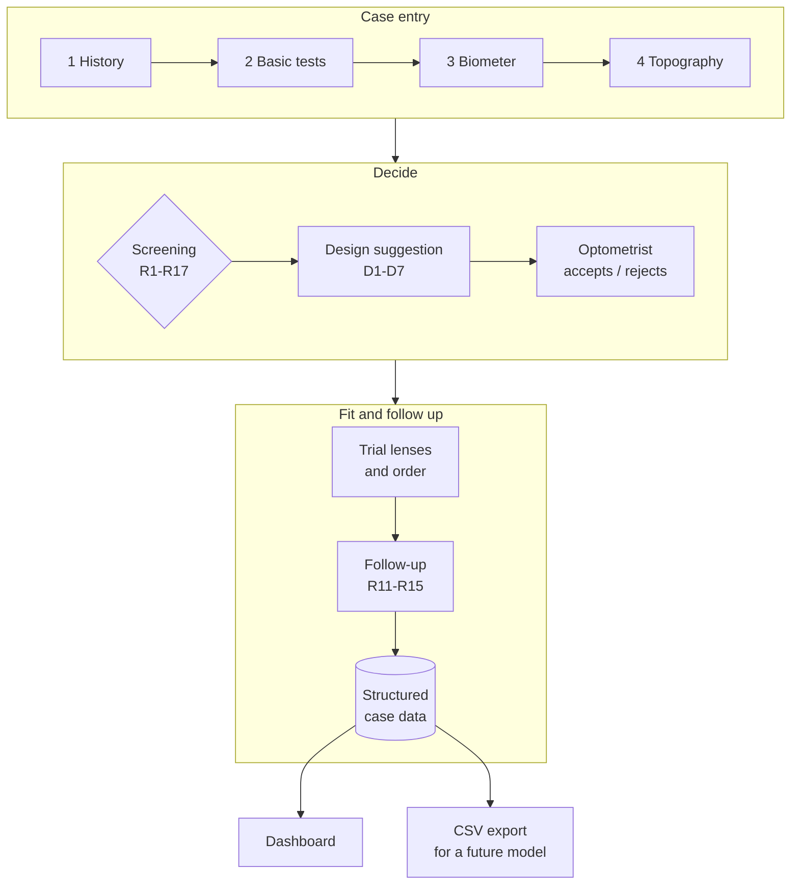
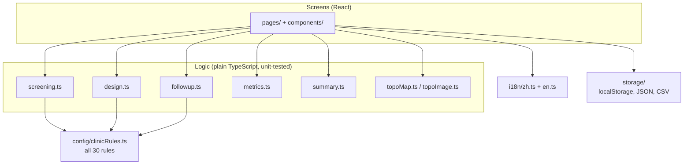

# Ortho-K Fitting Assistant · 角膜塑形镜验配助手

[](https://github.com/WHYNOT-LUO/ortho-k-fitting-assistant/actions/workflows/deploy.yml)


[](LICENSE)

**English** · [简体中文](README.zh-CN.md)

A decision-support web app for **orthokeratology (ortho-k) lens fitting**. It
turns a clinic's fitting workflow into a structured tool: enter the exam,
screen it against the clinic's rules, get a 4-curve / 5-curve design
suggestion for the optometrist to accept or reject, and record every trial
lens, reorder and follow-up visit. The goal is **fewer trial lenses, fewer
factory reorders and more consistent fits**.

> [!WARNING]
> **Research and demonstration prototype. Not for clinical decisions.**
> Every suggestion must be judged by a qualified optometrist. The app does not
> diagnose and never calculates lens parameters. None of its 30 rules has been
> confirmed by the clinic yet, and it has only been tested with synthetic data.

**▶ Live demo: <https://whynot-luo.github.io/ortho-k-fitting-assistant/>**
Open it, then click **Load synthetic demo cases** (加载合成演示病例). Switch
language at the top right. Everything you enter stays in your own browser.


---

## Contents

- [Why this project](#why-this-project)
- [How it fits the clinic workflow](#how-it-fits-the-clinic-workflow)
- [Feature tour](#feature-tour)
- [The rules](#the-rules)
- [Validation](#validation)
- [Value for clinics and manufacturers](#value-for-clinics-and-manufacturers)
- [Architecture](#architecture)
- [Data and privacy](#data-and-privacy)
- [Run, build and deploy](#run-build-and-deploy)
- [Changing a rule](#changing-a-rule)
- [Limitations](#limitations)
- [Roadmap](#roadmap)
- [Research background](#research-background)
- [About](#about)

---

## Why this project

Ortho-k lenses are rigid lenses worn overnight to reshape the cornea and slow
myopia in children. Each lens is **custom-made by a factory** from the eye's
measurements. When the first fit is wrong, the clinic spends more trial lenses
and chair time, and the factory has to remake the lens.

I spent time at a local clinic learning how ortho-k lenses are fitted, alongside
my own research on tear-film flow under ortho-k lenses. Fitting depends on
reading many numbers together (corneal curvature, e-value, corneal thickness,
refraction, axial length and more) against rules that live in each
optometrist's head. This project writes those rules down, applies them the same
way every time, and records what happened. That makes the work **faster, more
consistent and measurable**.

## How it fits the clinic workflow



| Clinic step | Where it lives in the app |
|---|---|
| History, basic tests, biometer, topography | **New case / Edit** form, right and left eye side by side |
| Suitability decision | **Screening** tab (Part 2) |
| Lens design choice | **Design** tab (Part 3) |
| Trial lens + fluorescein evaluation, ordering, follow-up | **Follow-up** tab (Part 4) |
| Reporting to optometrist and parents | **Summary** tab (Part 5) |
| Cost and quality numbers | **Dashboard** (Part 6) |
| Rule sign-off | **Rules** page |

---

## Feature tour

### 1 · Case entry


- **Every measurement from the clinic's instruments**, per eye:
  - **Autorefractor:** S, C, axis from the average line, plus keratometry K1/K2.
  - **Biometer:** AL, CCT, AD, LT, VT, K1/K2, AST, pupil, WTW.
  - **Topography:** Sim K1/K2 with axes at 3, 5 and 7 mm, e-values at 6, 7 and 8 mm, shape factor, keratoconus panel.
- **Calculated for you:**
  - spherical equivalent (S + C/2) and corneal astigmatism (K2 − K1)
  - DK at each topography zone
  - the **average and SD** from repeated biometer readings (paste `450, 496, 450, 496, 450` and you get 468.4 ± 22.5)
- **Typo guard:** values outside a plausible range turn yellow (for example AL 2.48 instead of 24.8). This warns but never blocks saving.
- **Anonymous by design:** IDs like `OK-2026-0001`, age in whole years only, and no fields for name, birth date or phone number.
- **Helpers:** copy right-eye data to the left eye, and a warning before leaving with unsaved changes.

### 2 · Suitability screening


- Each fitted eye is checked against the clinic rules. Every flag shows:
  - a **level**: OK / Note / Caution / Stop
  - a **plain-language reason with the actual numbers**
  - the **rule ID**, and whether the rule is still unconfirmed
- **Never silent:** missing data shows as **“not checked”** with the missing field named, never as OK.
- **Rules affect each other:** a measurement whose repeated readings have a high SD (R17) marks the results that use it as unreliable. LT > 4 mm without cycloplegic refraction (R6) does the same for refraction-based results.
- **The optometrist can respond** to each flag with **Agree / Disagree / Noted** plus a note. Responses are saved and exported, so the rules themselves can be audited later.

### 3 · Design suggestion (4-curve vs 5-curve)

| Rule conflict: both reasons shown | Decisions recorded, toric suggested |
|---|---|
|  |  |

- Rules D1–D7 suggest **4-curve** or **5-curve**, each with its reason.
- When both match (for example a child with low myopia), the app shows a **conflict** with both reasons. **It never picks silently**; the optometrist decides.
- It also suggests **considering a toric design**, from refractive astigmatism (R9) or a vertical thick tear layer seen during trial fitting (R15).
- The decision is stored with the suggestion at that moment, the rule IDs and the **rules version**, so it stays traceable after the rules change.
- The lens actually ordered can be copied in from the manufacturer's software. The app records it but **never calculates it**.

### 4 · Follow-up


- **Axial length over time** for both eyes, with growth scaled to mm/year over a 12-month window (R11): 0.20–0.30 mm/year is “possibly weak control, may be normal growth”.
- **Visit log:**
  - every trial lens, with its fluorescein result (loose / ideal / tight), the direction of any thick tear layer, and the adjustment made
  - reorders with a reason
  - the “fit successful” tick
  - AL, refraction, over-refraction and post-wear topography
- **Supplier-guide step (G1):** after a fluorescein result, the adjustment is pre-filled (loose → steeper, ideal → keep, tight → flatter). Direction only, never a value.
- **Checked automatically:** red inside the central 3 mm (R12), under-correction (R13), over-correction (R14) and a thick tear layer (R15).


### Simulated topography maps (demo cases only)

| Before fitting (case 08) | After wear, decentred (case T1, month 12) |
|---|---|
|  |  |

- **Drawn from each demo case's own numbers:**
  - a toric conic surface matched to the 5 mm Sim K, flattening with the e-value
  - after wear: a flattened centre scaled to the correction, a steeper ring, and a decentred zone when the visit records red in the central 3 mm
- **Image check on every post-wear map:** the experimental check that counts red pixels in the central 3 mm runs automatically, so the demo shows the whole loop. A test confirms that across all the demo visits, it flags exactly the visits marked “red in central 3 mm”.
- **Labelled and only for demos:** every map is watermarked **SIMULATED** and can be saved as a PNG. They appear **only for synthetic cases**, because a smooth model map for a real patient could hide real irregularity such as keratoconus.
- **Real maps:** you can upload a real post-wear map, mark its centre and scale, and run the same red-pixel check. It is experimental and has not been validated on real maps.

### 5 · Summaries and data export


- **Optometrist summary:** key flags with rule IDs, the design decision, follow-up flags and the fitting outcome.
- **Parent note:** explains each number in everyday words (what axial length is, why it is measured), uses no rule IDs, and **makes no promises about results**.
- **Template text, not an LLM:** both are built from the rules, so the same case always gives the same text and nothing leaves the device.
- **CSV export (Excel-ready):**
  - **one row per eye:** measurements → flags → design → trial lenses → outcome
  - **one row per visit**
  - a JSON backup and import as well

### 6 · Dashboard


- **Six numbers that show cost and quality:**
  - trial lenses per case and per eye
  - the share of cases needing a fit-related reorder (lost or damaged lenses counted separately)
  - average visits until a successful fit
  - the right-first-time rate
  - how often the design suggestion was accepted
  - how many cases and eyes the numbers come from
- **Charts:** trial lenses per eye, and reorder reasons.
- **Cost estimate:** enter your own unit costs to see the avoidable cost.
- **Per-case table** and a toggle to exclude the synthetic cases.

### Rules page


Every rule with its source, the assumption made where the clinic notes were
unclear, the open question it depends on, and a printable sign-off checklist
for the optometrist.

---

## The rules

All 30 rules and thresholds live in **one file**,
[`src/config/clinicRules.ts`](src/config/clinicRules.ts). Each rule records its
source and assumptions, and has a `confirmed` switch.

| Rule | Checks | Flags when (current value) | Level |
|---|---|---|---|
| R1–R3 | Corneal curvature K | Below 40 D: weaker effect (R2). Above 46 D: **rule out keratoconus, stop and refer** (R3) | Caution / **Stop** |
| R4 | e-value @6 mm | Above 0.60: stronger effect but may feel tight. Below 0.40: weaker effect | Caution / Note |
| R5 | Central corneal thickness | Below 500 μm: limited correction range | Caution |
| R6 | Lens thickness LT | Above 4.0 mm without cycloplegic refraction: do cycloplegic refraction first | Caution |
| R7 | Myopia (sphere) | Beyond −6.00 D: outside the best range. Plus sphere: no myopia, check the data | Caution / Note |
| R8–R9 | Refractive astigmatism C | 1.00–2.00 D: consider toric. Above 2.00 D: outside the rules | Note / Caution |
| R10 | 7 mm vs 5 mm Sim K | Differs by more than 0.50 D: parameters may need adjusting | Caution |
| R11 | Axial length growth | 0.20–0.30 mm/yr: possibly weak control. Above 0.30: likely weak | Caution |
| R12 | Post-wear topography | Red inside the central 3 mm: decentration, air bubble or dry spot | Caution |
| R13–R14 | Over-refraction | ≤ −0.50 D under-correction; ≥ +0.50 D over-correction | Caution |
| R15 | Fluorescein tear layer | Too thick in one direction; vertical suggests toric | Caution |
| R16 | High-risk child | High myopia, fast progression (≥ 0.50 D/yr) or AL ≥ 26 mm: check IOP and fundus | Caution |
| R17 | Measurement reliability | SD above AL 0.02 mm / CCT 10 μm / K 0.25 D: re-measure | Caution |
| N1–N3 | Keratoconus panel, ocular surface, allergic rhinitis | Suspect panel stops; abnormal surface cautions; rhinitis is a note | Stop / Caution / Note |
| D1–D7 | Design suggestion | See [Design suggestion](#3--design-suggestion-4-curve-vs-5-curve) | Suggestion only |
| G1 | Supplier fitting guide | Loose → steeper, ideal → keep, tight → flatter | Direction only |

<details>
<summary><b>Assumptions waiting for the optometrist's confirmation</b></summary>

| Rule | What the app assumes for now | Open question |
|---|---|---|
| R1–R3 | Uses keratometer K1/K2; falls back to topography 5 mm Sim K, then biometer K | — |
| R4 | e @6 mm; 0.40–0.60 counts as “about 0.5” | Q3 |
| R6 | No flag if the refraction is already cycloplegic | — |
| R8/R9 | Uses refractive cylinder C, not corneal astigmatism | Q6 |
| R10 | Compares 7 mm with 5 mm Sim K, in dioptres, either meridian | Q1 |
| R11 | 12-month window scaled to mm/year; at least 6 months between readings (about a week of slack) | Q2 |
| R13/R14 | ±0.50 D on over-refraction | — |
| R16 | −6.00 D, 0.50 D/yr, 26.00 mm; applied at any age | — |
| R17 | SD limits AL 0.02 mm, CCT 10 μm, AD/LT/VT 0.05 mm, K 0.25 D (population SD) | — |
| D2 / D4 | “High myopia” = −4.00 D or more; “child” = under 12 | Q4 |
| D7 | Regular cornea = corneal astigmatism ≤ 1.50 D, K within 40–46 D, no R10 flag, keratoconus panel not suspect | — |
| G1 | Direction only; step sizes unknown | Q5 |
| B1 | Clinic's current trial-lens and reorder numbers not yet provided | Q7 |

</details>

## Validation

The rules are plain functions, separate from the screens, so they can be tested
directly. **All 100 automated tests** run before every deployment.

The clinic notes include four synthetic test cases with expected results. The
app reproduces them exactly:

| Case | Expected (clinic notes) | App result |
|---|---|---|
| T1 typical candidate | Suitable, no warnings; design conflict; R11 at 0.28 mm in 12 months; R12 at month 12 | Same |
| T2 borderline | R2, R4, R5, R9, R16 | Exactly these five |
| T3 should not proceed | R3 first, then R7, R6, R16 | Exactly these four, R3 first |
| T4 unreliable measurement | R17 on CCT (readings 450 / 496, SD ≈ 22) | R17, and R5 marked unreliable |

The tests also cover:
- **Thresholds:** every boundary (for example 46.00 D passes, 46.25 D stops), with no floating-point errors.
- **Follow-up:** the R11 window, the over-refraction rules, and the supplier-guide steps.
- **Dashboard:** every metric definition.
- **Exports:** the CSV format, including no dates and no formula injection.
- **Storage:** backup round-trips, and keeping unreadable saved data aside.
- **Wording:** both languages, with no leftover placeholders and no promises in the parent note.
- **Simulated maps:** they match the Sim K, and the image check agrees with the visit records.

## Value for clinics and manufacturers

**Today (prototype).**
- The app makes a clinic's fitting rules explicit and applies them the same way every time.
- It records every trial lens and reorder, so a clinic can see **where fitting costs leak**: trial lenses per case, fit-related reorder rate, visits until success and right-first-time rate.

**Next.**
- Each case is stored as structured data: measurements → flags → design → trial lenses → outcome.
- With enough cases, that data can train a **first-fit prediction model**.
- [`docs/ml-data-plan.md`](docs/ml-data-plan.md) sets out what data that needs and roughly how many cases: about 300–500 eyes for a first model.

**Possible business model (not yet tested).**
- A subscription for clinic chains to standardise fitting across branches.
- Licensing to lens manufacturers, who carry the cost of remakes.

None of this is proven yet. The next step is confirming the rules with an
optometrist and trialling real anonymised cases.

---

## Architecture



```
src/
  config/clinicRules.ts     every rule and threshold, in one editable file
  domain/
    types.ts                case data model (no name / birth-date / phone fields)
    fieldSpecs.ts           each exam field once: label, unit, plausible range
    screening.ts            Part 2: R1–R10, R16, R17, N1–N3
    design.ts               Part 3: D1–D7 and the decision record
    followup.ts             Part 4: R11–R15 and supplier-guide step G1
    metrics.ts              Part 6: dashboard numbers
    summary.ts              Part 5: optometrist and parent text
    topoMap.ts              simulated topography maps (demo cases)
    topoImage.ts            red-pixel check for topography images
    format.ts               shared rounding and number formatting
    *.test.ts               unit tests
  storage/                  localStorage, JSON backup/import, CSV export
  i18n/                     all wording, Chinese and English (type-checked to match)
  components/, pages/       the screens
  data/syntheticCases.ts    10 demo cases, all labelled SYNTHETIC
docs/
  ml-data-plan.md           data plan for a future first-fit model
  screenshots/              images used in this README
```

**Tech stack:** React 18, TypeScript, Vite, Vitest, Chart.js. No backend, no
external requests at runtime.

**Key design decisions:**
1. **No server.** Data stays in the browser, which keeps it private and makes hosting free. The trade-off is one browser per device, so there is a JSON backup.
2. **One rules file.** Every number the app judges by is in one place, with its source, assumptions and a `confirmed` switch.
3. **Logic separate from screens.** This makes the rules testable, including the exact expected results from the clinic notes.
4. **Never silent.** Missing data is “not checked”, conflicts show both reasons, and unreliable measurements are marked.
5. **Decision support only.** The optometrist decides; the app records the decision and the rules version.
6. **Honest naming.** Summaries are template text, not an LLM. The “AI” step is the future model trained on the exported data.

## Data and privacy

- **No identifying fields:** the form has no name, birth date, phone or ID number. Cases use anonymous IDs, and age is stored in whole years.
- **Stays on the device:** data lives only in the browser's `localStorage` and is never uploaded.
- **Private CSV export:** **no calendar dates** (days since the first exam instead) and **no free-text notes**, which could contain names. Spreadsheet formula injection is neutralised.
- **Demo data is labelled:** demo cases are marked `synthetic = 1` in exports and badged in the app.
- **Real data needs permission:** use real patient data only with the clinic's permission.

## Run, build and deploy

Requires [Node.js](https://nodejs.org/) 20 or newer.

```bash
npm install            # install dependencies (once)
npm run dev            # start the app at http://localhost:5173
npm test               # run the unit tests
npm run build          # production build in dist/
npm run build:offline  # one self-contained HTML file in offline/
```

**GitHub Pages.** [`.github/workflows/deploy.yml`](.github/workflows/deploy.yml)
runs the tests, builds the app and publishes it on every push to `main`. To
host your own copy:
1. Fork the repository.
2. Go to **Settings → Pages → Source: GitHub Actions**.
3. Push.

**Offline version (e.g. mainland China without a VPN).** `github.io` can be
slow or unreachable there. `npm run build:offline` puts the whole app into one
HTML file of about 490 KB.
- Send it by WeChat, email or USB; it opens by double-click in Chrome or Edge, with no internet needed.
- It keeps its data in that browser, separate from the website. Move cases between the two with Backup / Import.

## Changing a rule

1. Edit the value in [`src/config/clinicRules.ts`](src/config/clinicRules.ts).
2. Set `confirmed: true` once the optometrist agrees, and update or remove the `assumption`.
3. Bump `RULES_VERSION`. Saved decisions keep the version they were made under.
4. Run `npm test`. Tests that check the old threshold will tell you what to update.

The **Rules** page in the app shows the result and prints a sign-off checklist.

## Limitations

- **Not validated.** The rules come from one clinic's notes and an AI search (the design rules), and none is confirmed yet. Only synthetic data has been used.
- **Demo numbers mean nothing about real clinics.** There are ten synthetic cases: T1–T4 from the clinic notes plus six made up for the dashboard.
- **One browser, one device.** No accounts, sync or multi-user access.
- **Manual entry.** Values are typed from printouts; only soft range checks catch typos.
- **Experimental image check.** The red-pixel check has not been validated on real topography maps, and its 5% threshold is a placeholder.
- **Free-text lens parameters.** Trial-lens and order parameters are free text until the supplier guide's full format is known.

## Roadmap

- [x] Case entry, screening, design suggestion, follow-up, summaries, dashboard
- [x] CSV/JSON export, simulated maps for demos, offline single-file build
- [ ] Optometrist sign-off of all 30 rules (open questions Q1–Q7)
- [ ] Trial with real anonymised cases, with the clinic's permission
- [ ] Structured trial-lens and order fields for the clinic's lens brand
- [ ] Read autorefractor and biometer printouts automatically
- [ ] With enough cases: a first “will this first lens fit?” model compared against the dashboard baseline

## Research background

- Faria-Ribeiro et al. (2016). Morphology, topography, and optics of the orthokeratology cornea. *Journal of Biomedical Optics*, 21(7), 075011. <https://doi.org/10.1117/1.JBO.21.7.075011>
- Zhang et al. (2025). Analyzing corneal biomechanical response in orthokeratology with differing back optic zone diameter: a comparative finite element study. *Contact Lens and Anterior Eye*, 48(4), 102401. <https://doi.org/10.1016/j.clae.2025.102401>
- Wan et al. (2020). Orthokeratology with increased compression factor (OKIC): study design and preliminary results. *BMJ Open Ophthalmology*, 5, e000345. <https://doi.org/10.1136/bmjophth-2019-000345>
- Marcotte-Collard et al. (2018). Analysis of two orthokeratology lens designs and comparison of their optical effects on the cornea. *Eye & Contact Lens*, 44(5), 322–329. <https://doi.org/10.1097/ICL.0000000000000495>
- Sample-size references for the future model are in [`docs/ml-data-plan.md`](docs/ml-data-plan.md).

## About

A high-school independent research project by
[@WHYNOT-LUO](https://github.com/WHYNOT-LUO). The fitting workflow and rules
come from hands-on time at a local clinic, and the rules and test cases are
taken from my clinic notes. The app was built with AI coding assistance
(Claude Code).

Released under the [MIT License](LICENSE). The license covers the code; it
does not make the app suitable for clinical use (see the warning at the top).
