# 角膜塑形镜验配助手 · Ortho-K Fitting Assistant

[](https://github.com/WHYNOT-LUO/ortho-k-fitting-assistant/actions/workflows/deploy.yml)


[English](README.md) · **简体中文**

一个辅助**角膜塑形镜（OK 镜）验配**的网页工具。它把诊所的验配流程做成结构化工具：
录入检查数据 → 按诊所规则自动筛查 → 给出四弧区 / 五弧区设计建议，由验光师接受或拒绝 →
记录每一片试戴片、每一次重订和每次复诊。目标是**减少试戴片和工厂重订，让验配更一致**。

> [!WARNING]
> **研究与演示原型，不得用于临床决策**。
> 所有建议都须由有资质的验光师判断。应用不做诊断，也不计算镜片参数。
> 30 条规则目前全部**未经诊所确认**，只用合成（虚构）数据测试过。

**▶ 在线演示：<https://whynot-luo.github.io/ortho-k-fitting-assistant/>**
打开后点 **加载合成演示病例**，右上角可切换中英文。你输入的数据只保存在你自己的浏览器里。
在中国大陆无法打开时，可使用[离线版](#离线版中国大陆无需-vpn)。

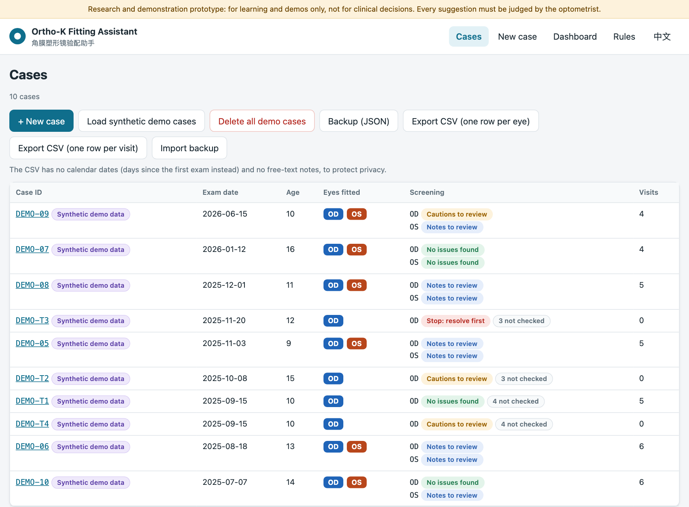

---

## 目录

- [为什么做这个项目](#为什么做这个项目)
- [与诊所流程的对应](#与诊所流程的对应)
- [功能一览](#功能一览)
- [规则](#规则)
- [验证](#验证)
- [对诊所和厂家的价值](#对诊所和厂家的价值)
- [技术结构](#技术结构)
- [数据与隐私](#数据与隐私)
- [运行、构建和部署](#运行构建和部署)
- [修改规则](#修改规则)
- [已知限制](#已知限制)
- [路线图](#路线图)
- [研究参考](#研究参考)
- [关于](#关于)

---

## 为什么做这个项目

角膜塑形镜是夜间配戴、用来重塑角膜、延缓儿童近视加深的硬性镜片。每一片都由**工厂按眼睛数据定制**。
第一次验配不合适，诊所就要多用试戴片、多占椅位时间，工厂还要重新做镜片。

我在一家诊所学习了角膜塑形镜的验配，同时在做 OK 镜下泪液流动的独立研究。验配需要同时看很多数字
（角膜曲率、e 值、角膜厚度、验光度数、眼轴等），而判断规则大多在验光师的经验里。
这个项目把规则写下来，每次都同样地执行，并把结果记录下来，让验配**更快、更一致、可以量化**。

## 与诊所流程的对应

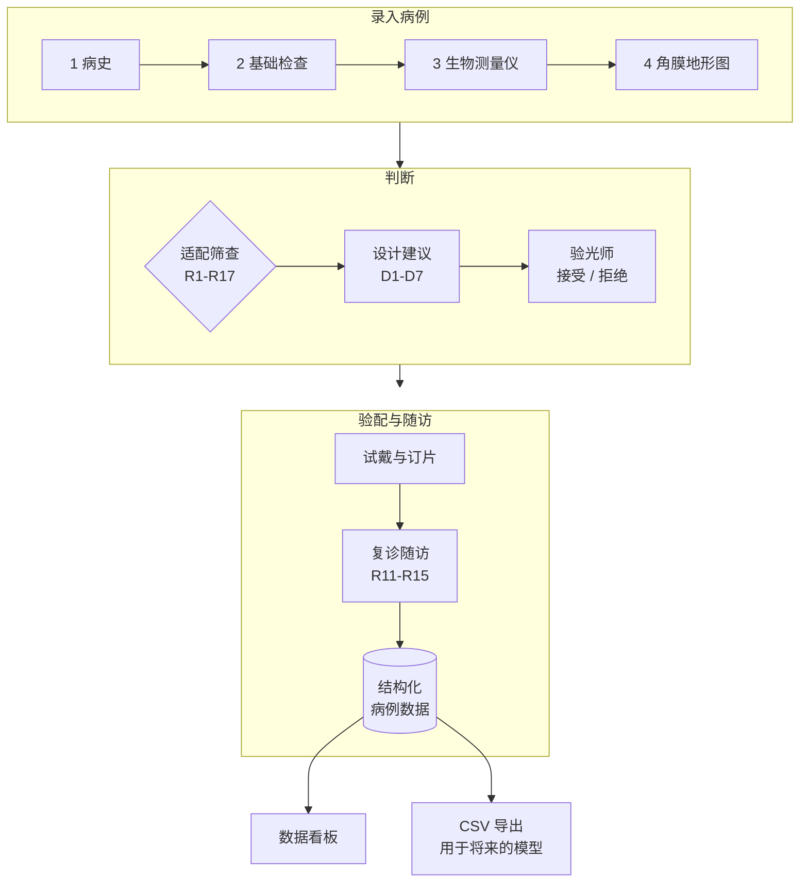

| 诊所步骤 | 在应用中的位置 |
|---|---|
| 病史、基础检查、生物测量仪、地形图 | **新建 / 编辑病例**表单，左右眼并排 |
| 是否适合验配 | **适配筛查**标签（第 2 部分） |
| 镜片设计选择 | **设计建议**标签（第 3 部分） |
| 试戴片与荧光评估、订片、复诊 | **复诊随访**标签（第 4 部分） |
| 给验光师和家长的说明 | **摘要**标签（第 5 部分） |
| 成本与质量数字 | **数据看板**（第 6 部分） |
| 规则确认 | **规则**页 |

---

## 功能一览

### 1 · 录入病例

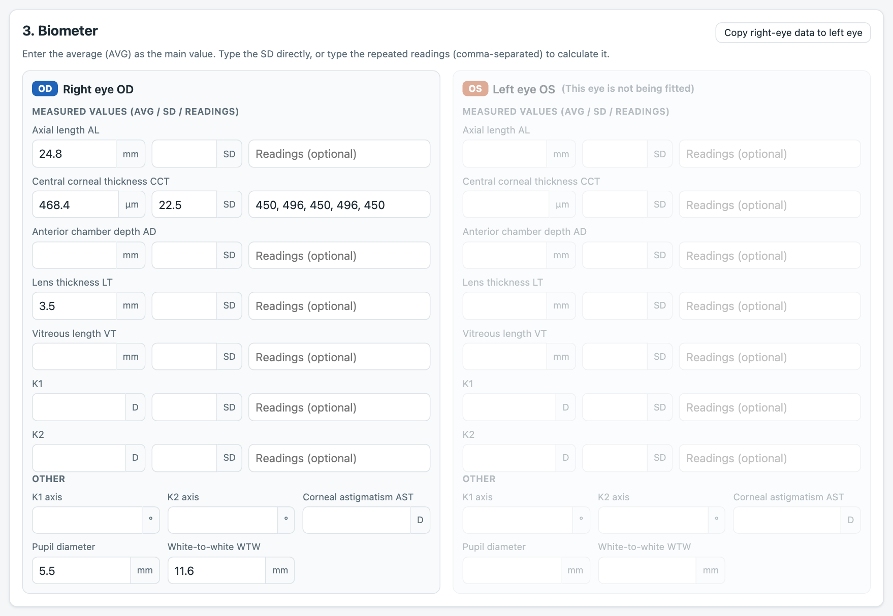

- **诊所所有仪器的数据**（左右眼各一份）：
  - **电脑验光**：取平均值行的 S、C、轴位，以及角膜曲率 K1/K2。
  - **生物测量仪**：AL、CCT、AD、LT、VT、K1/K2、AST、瞳孔、WTW。
  - **地形图**：3 / 5 / 7 mm 的 Sim K1/K2 及轴位，6 / 7 / 8 mm 的 e 值，形状因子，圆锥角膜筛查。
- **自动计算**：
  - 等效球镜 S.E. = S + C/2，角膜散光 K2 − K1
  - 每个区的 DK
  - 多次读数的**平均值和 SD**（输入 `450, 496, 450, 496, 450` 得到 468.4 ± 22.5）
- **防止打错**：超出常见范围的数值会变黄（例如把 24.8 打成 2.48），只提醒、不阻止保存。
- **匿名设计**：病例编号形如 `OK-2026-0001`，年龄只记周岁，没有姓名、出生日期、电话字段。
- **辅助功能**：一键把右眼数据复制到左眼，离开页面前会提醒保存。

### 2 · 适配筛查

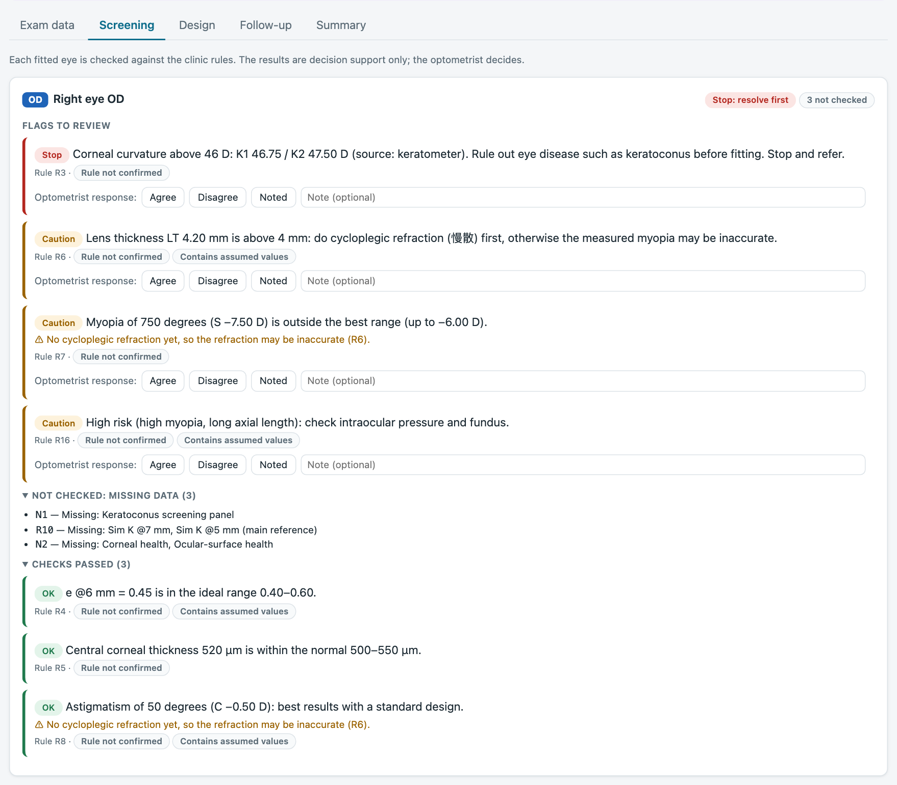

- 每只验配眼都按诊所规则自动检查，每条提示都显示：
  - **等级**：通过 / 提示 / 注意 / 暂停
  - **白话原因和实际数值**
  - **规则编号**，以及这条规则是否尚未确认
- **不会悄悄跳过**：缺数据时显示“**未检查**”并写明缺什么，永远不会当作“通过”。
- **规则之间会互相提醒**：多次读数 SD 过大（R17）的测量值，会把用到它的结果标为“不可靠”。LT > 4 mm 且没有慢散验光（R6）时，基于验光度数的结果也会加注提醒。
- **验光师可以回应**：每条提示可以选**同意 / 不同意 / 已知悉**并写备注，意见会保存并导出，将来可以用来检验规则本身。

### 3 · 设计建议（四弧区 / 五弧区）

| 规则冲突：两边理由都列出 | 已记录的决定，并建议考虑环曲 |
|---|---|
| 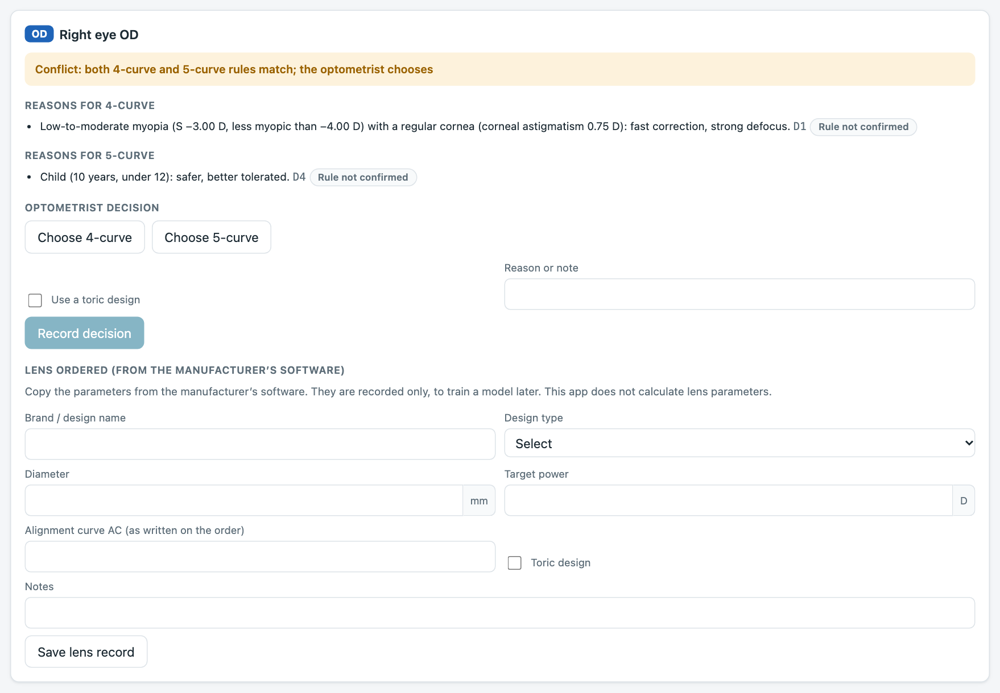 | 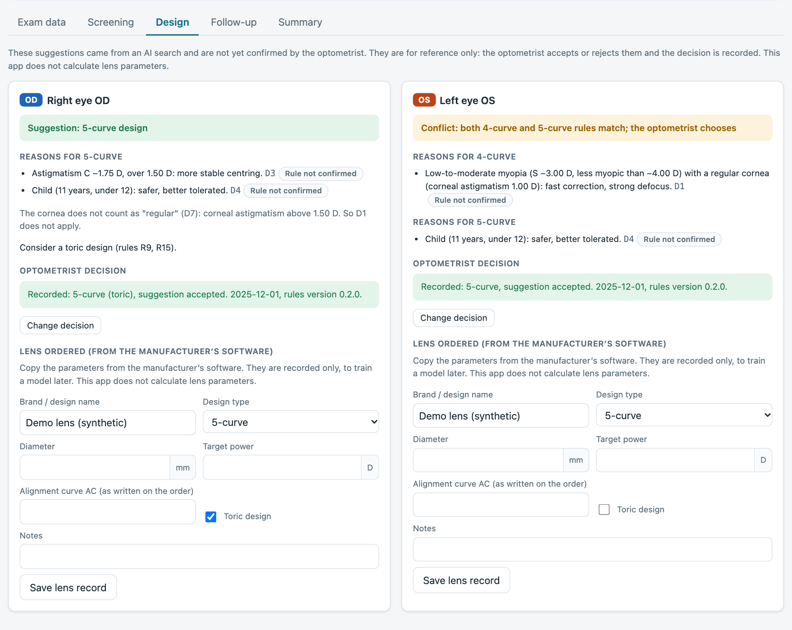 |

- 规则 D1–D7 给出**四弧区**或**五弧区**建议，并写明理由。
- 两边都满足时（例如低度近视的儿童），显示**规则冲突**，两边理由都列出。**应用不会悄悄替你选**，由验光师决定。
- 根据屈光散光（R9）或试戴时泪液层垂直方向过厚（R15），提示**考虑环曲设计**。
- 保存决定时，会一并记录当时的建议、规则编号和**规则版本**，规则以后改了也能追溯。
- 可以记录厂家软件给出的实际订片参数，但**只记录、不计算**。

### 4 · 复诊随访

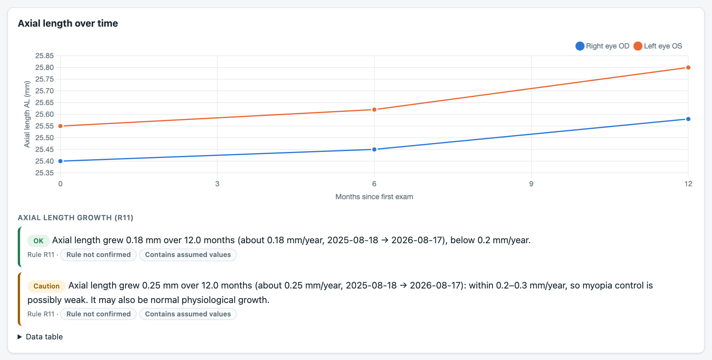

- **双眼眼轴变化曲线**，按 12 个月窗口折算成每年增长（R11）：0.20–0.30 mm/年为“近视控制可能偏弱，也可能是正常生长”。
- **就诊记录**：
  - 每一片试戴片，包括荧光评估（偏松 / 适中 / 偏紧）、泪液层过厚方向和实际调整
  - 重订及原因
  - “验配成功”勾选
  - 眼轴、验光、戴镜验光、戴镜后地形图
- **供应商指南步骤（G1）**：选了荧光结果后，自动预填调整方向（偏松 → 加一档，适中 → 保持，偏紧 → 减一档）。只给方向，不给数值。
- **自动检查**：中央 3 mm 出现红色（R12）、欠矫（R13）、过矫（R14）、泪液层过厚（R15）。

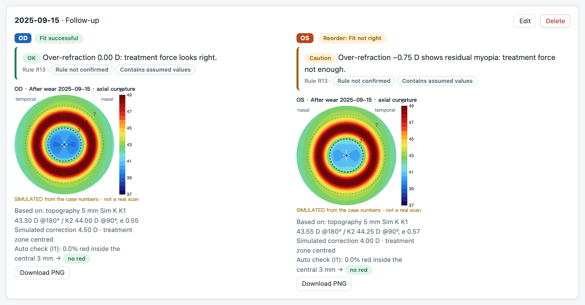

### 模拟地形图（仅限演示病例）

| 戴镜前（病例 08） | 戴镜后偏位（T1，第 12 个月） |
|---|---|
| 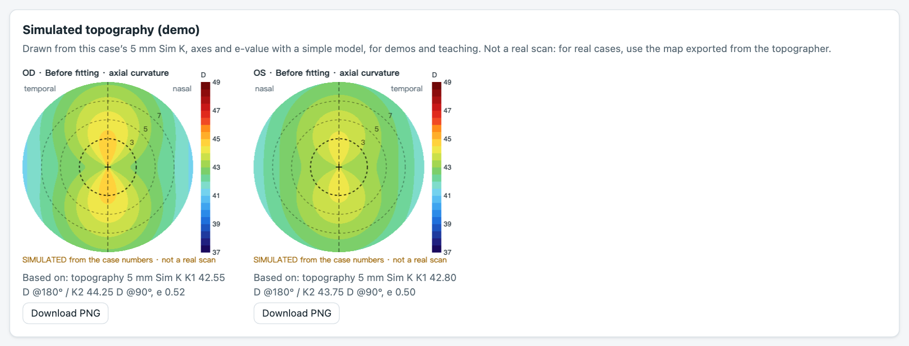 | 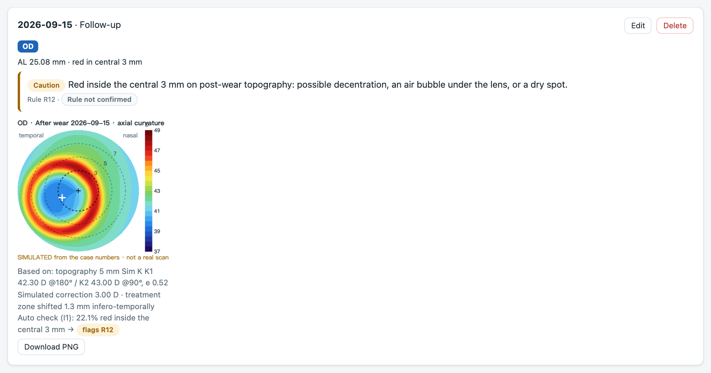 |

- **按每个演示病例自己的数字画出**：
  - 角膜形状是与 5 mm Sim K 一致的环曲面二次曲面，向周边变平的程度由 e 值决定
  - 戴镜后：中央变平的程度对应矫正量，周边有一圈变陡的红环；就诊记录勾选了中央 3 mm 红色时，治疗区会画成偏位
- **每张戴镜后的图都自动做图片检查**：实验性的“中央 3 mm 红色像素”检查会自动运行，演示完整流程。测试确认：所有演示就诊中，被检查提示的正好就是记录了中央红色的那些。
- **有标注，只用于演示**：每张图都标有 **SIMULATED（模拟）** 水印，可以下载 PNG。只给**合成病例**画，因为光滑的模型图可能掩盖真实患者的不规则（例如圆锥角膜）。
- **真实地形图**：可以上传真实的戴镜后地形图，标出中心和比例尺，做同样的红色检查。这是实验功能，尚未在真实地形图上验证。

### 5 · 摘要与数据导出

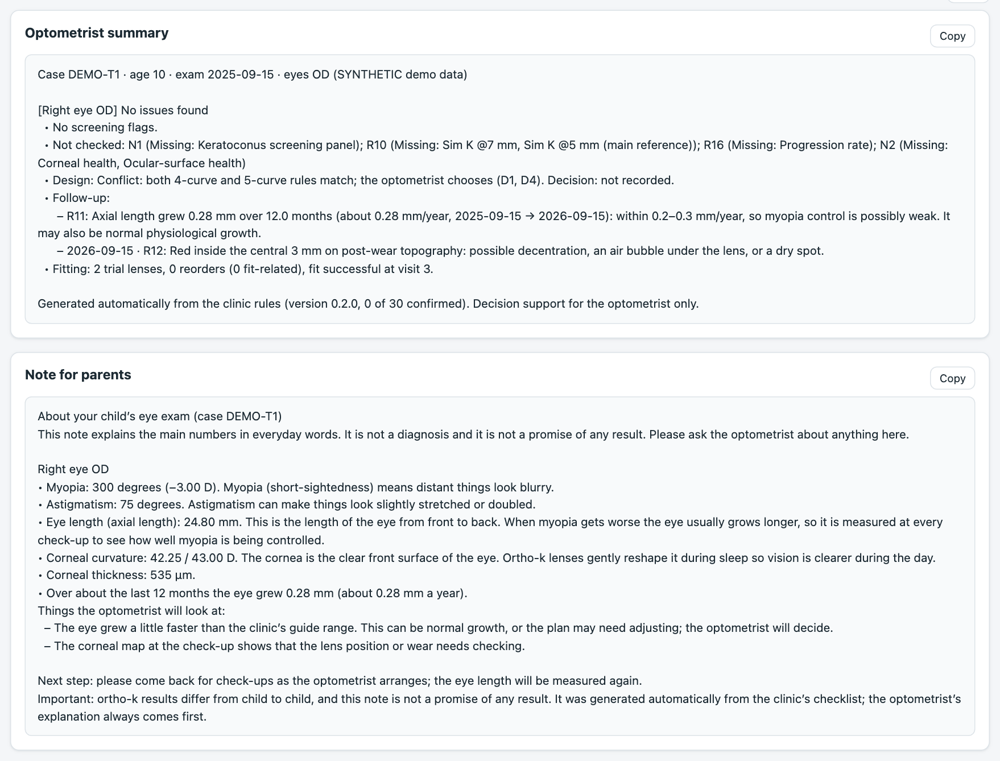

- **验光师摘要**：关键提示和规则编号、设计决定、复诊提示和验配结果。
- **家长说明**：用日常语言解释每个数字（眼轴是什么、为什么每次都测），不出现规则编号，**不承诺任何效果**。
- **由模板生成，不是大语言模型**：两份都按规则生成，同一个病例永远得到同样的文字，数据不离开设备。
- **CSV 导出（可用 Excel 打开）**：
  - **每眼一行**：检查数据 → 提示 → 设计 → 试戴 → 结果
  - **每次就诊一行**
  - 另有 JSON 备份和导入

### 6 · 数据看板

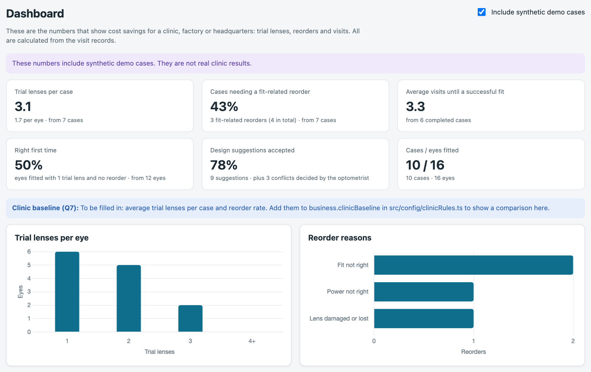

- **六个反映成本和质量的数字**：
  - 每例和每眼的平均试戴片数
  - 需要验配相关重订的病例比例（镜片损坏或丢失单独统计）
  - 验配成功前的平均就诊次数
  - 一次验配成功率
  - 设计建议的采纳率
  - 这些数字来自多少病例和多少只眼
- **图表**：每眼试戴片数分布、重订原因。
- **成本估算**：填入自己的单价，看到可避免的成本。
- **逐例明细表**，并可以选择不计入合成病例。

### 规则页

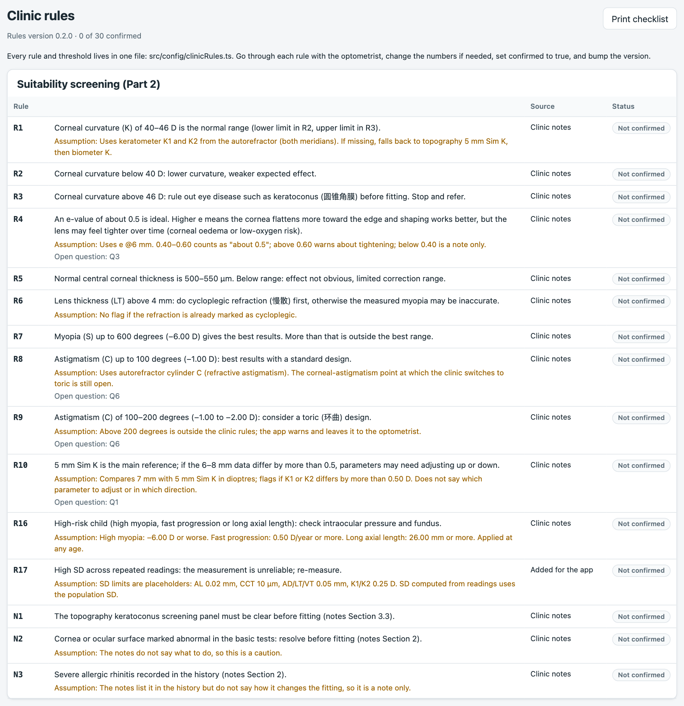

列出每条规则的来源、诊所笔记没说清时采用的假设、对应的待确认问题，并可打印给验光师签字确认的清单。

---

## 规则

全部 30 条规则和阈值都在**一个文件**里：[`src/config/clinicRules.ts`](src/config/clinicRules.ts)。
每条规则都记录了来源和假设，并有一个 `confirmed`（已确认）开关。

| 规则 | 检查什么 | 什么时候提示（当前数值） | 等级 |
|---|---|---|---|
| R1–R3 | 角膜曲率 K | 低于 40 D：效果较弱（R2）；高于 46 D：**先排除圆锥角膜，停止并转诊**（R3） | 注意 / **暂停** |
| R4 | e 值 @6 mm | 高于 0.60：效果更强但可能偏紧；低于 0.40：效果较弱 | 注意 / 提示 |
| R5 | 中央角膜厚度 | 低于 500 μm：矫正范围有限 | 注意 |
| R6 | 晶体厚度 LT | 大于 4.0 mm 且未做慢散：须先慢散验光 | 注意 |
| R7 | 近视（球镜） | 深于 −6.00 D：超出最佳范围；球镜为正：没有近视，请核对数据 | 注意 / 提示 |
| R8–R9 | 屈光散光 C | 1.00–2.00 D：考虑环曲；大于 2.00 D：超出规则范围 | 提示 / 注意 |
| R10 | 7 mm 与 5 mm Sim K | 相差超过 0.50 D：参数可能需要调整 | 注意 |
| R11 | 眼轴增长 | 0.20–0.30 mm/年：控制可能偏弱；大于 0.30：可能不足 | 注意 |
| R12 | 戴镜后地形图 | 中央 3 mm 出现红色：偏位、气泡或干燥点 | 注意 |
| R13–R14 | 戴镜验光 | ≤ −0.50 D 欠矫；≥ +0.50 D 过矫 | 注意 |
| R15 | 荧光泪液层 | 某方向过厚；垂直方向提示考虑环曲 | 注意 |
| R16 | 高风险儿童 | 高度近视、进展快（≥ 0.50 D/年）或眼轴 ≥ 26 mm：查眼压和眼底 | 注意 |
| R17 | 测量可靠性 | SD 超过 AL 0.02 mm / CCT 10 μm / K 0.25 D：重新测量 | 注意 |
| N1–N3 | 圆锥角膜筛查、眼表、过敏性鼻炎 | 筛查可疑则暂停；眼表异常为注意；鼻炎为提示 | 暂停 / 注意 / 提示 |
| D1–D7 | 设计建议 | 见[设计建议](#3--设计建议四弧区--五弧区) | 仅为建议 |
| G1 | 供应商验配指南 | 偏松 → 加一档，适中 → 保持，偏紧 → 减一档 | 只给方向 |

<details>
<summary><b>待验光师确认的假设</b></summary>

| 规则 | 目前的做法 | 待确认问题 |
|---|---|---|
| R1–R3 | 优先用电脑验光仪 K1/K2，没有时依次用地形图 5 mm Sim K、生物测量仪 K | — |
| R4 | 使用 e @6 mm；0.40–0.60 视为“约 0.5” | Q3 |
| R6 | 已做慢散验光就不提示 | — |
| R8/R9 | 用屈光散光 C，而不是角膜散光 | Q6 |
| R10 | 比较 7 mm 与 5 mm 的 Sim K，单位 D，任一子午线 | Q1 |
| R11 | 按 12 个月折算为每年增长；两次测量至少相隔 6 个月（允许约一周误差） | Q2 |
| R13/R14 | 戴镜验光 ±0.50 D | — |
| R16 | −6.00 D、0.50 D/年、26.00 mm；所有年龄适用 | — |
| R17 | SD 上限 AL 0.02 mm、CCT 10 μm、AD/LT/VT 0.05 mm、K 0.25 D（总体标准差） | — |
| D2 / D4 | “高度近视” = −4.00 D 及以上；“儿童” = 12 岁以下 | Q4 |
| D7 | 角膜规则 = 角膜散光 ≤ 1.50 D、K 在 40–46 D、无 R10 提示、圆锥角膜筛查不是可疑 | — |
| G1 | 只给方向，档位大小未知 | Q5 |
| B1 | 诊所现有的试戴片数和重订率尚未提供 | Q7 |

</details>

## 验证

规则是和界面分开的普通函数，可以直接测试。**全部 100 个自动测试**会在每次部署前运行。

诊所笔记里有 4 个合成测试病例及预期结果，应用的结果与之完全一致：

| 病例 | 笔记中的预期 | 应用结果 |
|---|---|---|
| T1 典型适合者 | 适合、无警告；设计冲突；12 个月眼轴增长 0.28 mm（R11）；第 12 个月 R12 | 一致 |
| T2 边界病例 | R2、R4、R5、R9、R16 | 恰好这 5 条 |
| T3 暂不宜验配 | R3 最优先，其次 R7、R6、R16 | 恰好这 4 条，R3 排第一 |
| T4 测量不可靠 | CCT 的 R17（读数 450 / 496，SD 约 22） | R17，且 R5 标为“不可靠” |

测试还包括：
- **阈值**：每个边界（例如 46.00 D 通过、46.25 D 暂停），且没有浮点误差。
- **复诊**：R11 的时间窗口、戴镜验光规则、供应商指南步骤。
- **看板**：每个指标的定义。
- **导出**：CSV 格式，包括不含日期、防止公式注入。
- **存储**：备份能完整还原，无法读取的数据会另存而不被覆盖。
- **文字**：两种语言都没有遗留的占位符，家长说明不承诺效果。
- **模拟地形图**：与 Sim K 一致，图片检查结果与就诊记录一致。

## 对诊所和厂家的价值

**现在（原型）**：
- 把诊所的验配规则写清楚，每次都同样执行。
- 记录每一片试戴片和每一次重订，诊所能看到**验配成本漏在哪里**：每例试戴片数、验配相关重订率、成功前就诊次数、一次成功率。

**下一步**：
- 每个病例都以结构化数据保存：检查数据 → 提示 → 设计 → 试戴 → 结果。
- 积累足够病例后，可以用这些数据训练“首片能否一次成功”的**预测模型**。
- [`docs/ml-data-plan.md`](docs/ml-data-plan.md) 说明了需要哪些数据、大约多少病例：第一个模型约 300–500 只眼。

**可能的商业模式（尚未验证）**：
- 面向连锁诊所的订阅服务，用来统一各分店的验配标准。
- 授权给承担重做成本的镜片厂家。

以上都还没有得到验证。下一步是与验光师确认规则，并用真实匿名病例试用。

---

## 技术结构

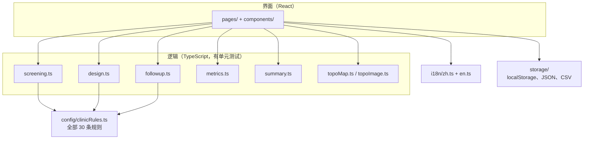

```
src/
  config/clinicRules.ts     全部规则和阈值（只改这一个文件）
  domain/                   判断逻辑：筛查、设计、复诊、指标、摘要、地形图（各有测试）
  storage/                  本地存储、JSON 备份/导入、CSV 导出
  i18n/                     中英文文字（程序会检查两种语言是否齐全）
  components/, pages/       界面
  data/syntheticCases.ts    10 个演示病例，全部标为“合成”
docs/
  ml-data-plan.md           将来训练模型的数据计划
  screenshots/              本说明中的截图
```

**技术栈**：React 18、TypeScript、Vite、Vitest、Chart.js。没有后端，运行时不访问任何外部服务器。

**关键设计决定**：
1. **没有服务器**。数据留在浏览器里，保护隐私，托管免费。代价是只在一台设备上，所以提供 JSON 备份。
2. **一个规则文件**。所有判断用的数字都在一处，并写明来源、假设和确认开关。
3. **逻辑和界面分开**。这样规则可以测试，包括诊所笔记里的预期结果。
4. **不会悄悄跳过**。缺数据显示“未检查”，冲突时两边理由都列出，不可靠的测量会被标出。
5. **只做决策辅助**。由验光师决定，应用记录决定和当时的规则版本。
6. **如实命名**。摘要是模板文字，不是大语言模型；真正的“AI”是将来用导出数据训练的模型。

## 数据与隐私

- **没有可识别身份的字段**：表单没有姓名、出生日期、电话、证件号，只用匿名编号，年龄只记周岁。
- **数据留在本机**：数据只存在浏览器的 `localStorage` 里，不会上传。
- **CSV 导出注意隐私**：导出的 CSV **不含日期**（改为距首次检查的天数），也**不含自由文字备注**（备注里可能有人名），并防止表格公式注入。
- **演示数据有标注**：演示病例在导出中标为 `synthetic = 1`，应用中也有标签。
- **真实数据须获许可**：使用真实患者数据前须获得诊所许可。

## 运行、构建和部署

需要 [Node.js](https://nodejs.org/) 20 或更新版本。

```bash
npm install            # 安装依赖（只需一次）
npm run dev            # 本地运行，打开 http://localhost:5173
npm test               # 运行单元测试
npm run build          # 生成发布版本（dist/）
npm run build:offline  # 生成单个离线 HTML 文件（offline/）
```

**GitHub Pages**：[`.github/workflows/deploy.yml`](.github/workflows/deploy.yml) 会在每次推送到 `main` 时运行测试、构建并发布。
要部署自己的副本：
1. Fork 本仓库。
2. 打开 **Settings → Pages → Source: GitHub Actions**。
3. 推送一次。

### 离线版（中国大陆无需 VPN）

`github.io` 在中国大陆可能很慢或打不开。`npm run build:offline` 会把整个应用打包成一个约 490 KB 的 HTML 文件。
- 可以通过微信、邮件或 U 盘发送，在电脑上用 Chrome 或 Edge 双击即可打开，不需要联网。
- 数据保存在打开它的浏览器里，和网站版分开；用“备份 / 导入备份”在两者之间转移病例。

## 修改规则

1. 在 [`src/config/clinicRules.ts`](src/config/clinicRules.ts) 里修改数值。
2. 验光师确认后把 `confirmed` 改为 `true`，并更新或删除 `assumption`（假设说明）。
3. 更新 `RULES_VERSION`。已保存的决定会保留当时的版本号。
4. 运行 `npm test`。检查旧阈值的测试会提示你哪里需要一起更新。

应用里的**规则**页会显示结果，并能打印确认清单。

## 已知限制

- **尚未验证**：规则来自一家诊所的笔记和一次 AI 搜索（设计规则），全部未经确认，只用过合成数据。
- **演示数字不代表真实诊所**：共 10 个合成病例，T1–T4 来自诊所笔记，另外 6 个是为看板编写的。
- **只在一个浏览器、一台设备上**：没有账号、同步或多人共用。
- **手工录入**：数值要从打印单上抄，只有“常见范围”的软提醒能发现打错。
- **图片检查是实验功能**：红色像素检查没有在真实地形图上验证，5% 阈值是暂定值。
- **镜片参数是自由文字**：试戴片和订片参数要等供应商指南的完整格式确定后，才能改成结构化字段。

## 路线图

- [x] 录入、筛查、设计建议、复诊、摘要、看板
- [x] CSV/JSON 导出、演示用模拟地形图、离线单文件版
- [ ] 验光师确认全部 30 条规则（待确认问题 Q1–Q7）
- [ ] 在诊所许可下用真实匿名病例试用
- [ ] 为诊所使用的镜片品牌增加结构化的试戴和订片字段
- [ ] 自动读取电脑验光仪和生物测量仪的打印单
- [ ] 数据足够后：训练第一个“首片能否一次成功”的模型，并与看板上的现状比较

## 研究参考

- Faria-Ribeiro et al. (2016). Morphology, topography, and optics of the orthokeratology cornea. *Journal of Biomedical Optics*, 21(7), 075011. <https://doi.org/10.1117/1.JBO.21.7.075011>
- Zhang et al. (2025). Analyzing corneal biomechanical response in orthokeratology with differing back optic zone diameter: a comparative finite element study. *Contact Lens and Anterior Eye*, 48(4), 102401. <https://doi.org/10.1016/j.clae.2025.102401>
- Wan et al. (2020). Orthokeratology with increased compression factor (OKIC): study design and preliminary results. *BMJ Open Ophthalmology*, 5, e000345. <https://doi.org/10.1136/bmjophth-2019-000345>
- Marcotte-Collard et al. (2018). Analysis of two orthokeratology lens designs and comparison of their optical effects on the cornea. *Eye & Contact Lens*, 44(5), 322–329. <https://doi.org/10.1097/ICL.0000000000000495>
- 模型样本量的参考文献见 [`docs/ml-data-plan.md`](docs/ml-data-plan.md)。

## 关于

这是 [@WHYNOT-LUO](https://github.com/WHYNOT-LUO) 的高中独立研究项目。验配流程来自我在一家诊所的实地学习，
规则和测试病例来自我的诊所笔记。应用在 AI 编程工具（Claude Code）的辅助下开发。

目前尚未选择开源许可证，作者保留所有权利。
